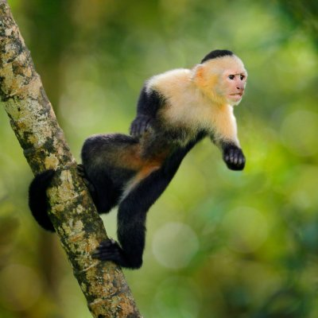
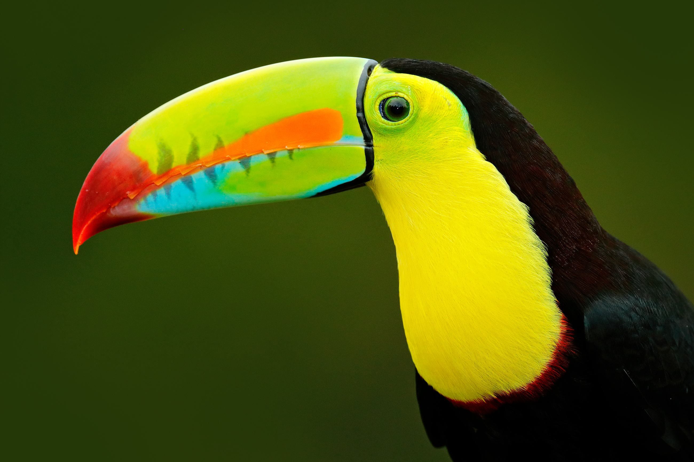
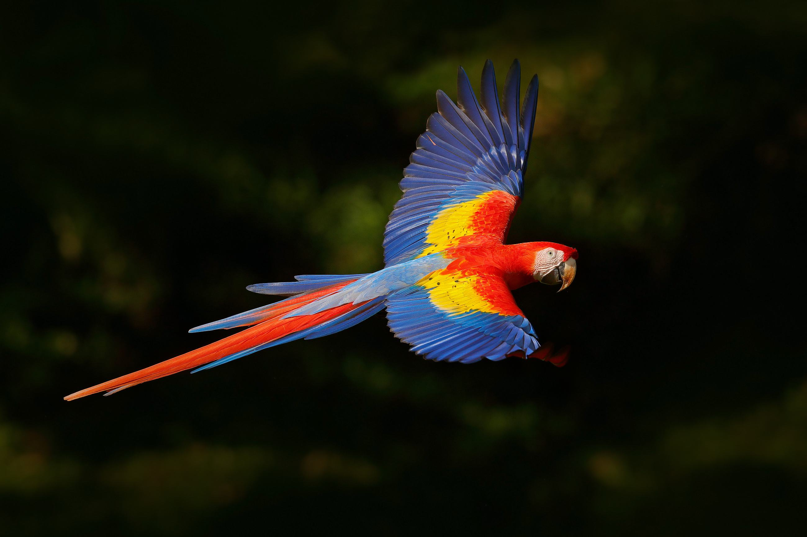
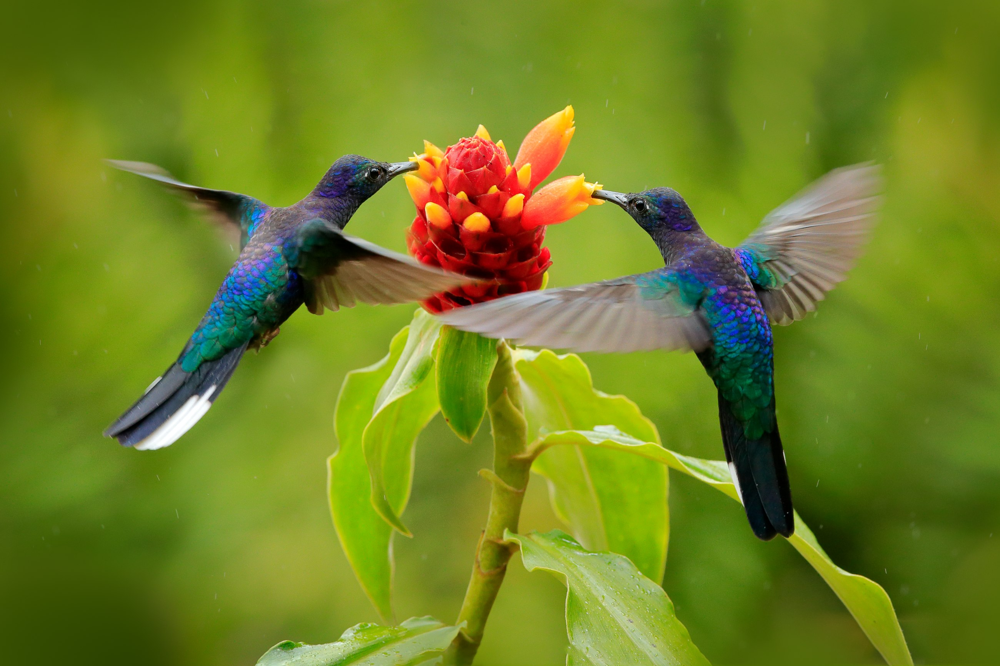
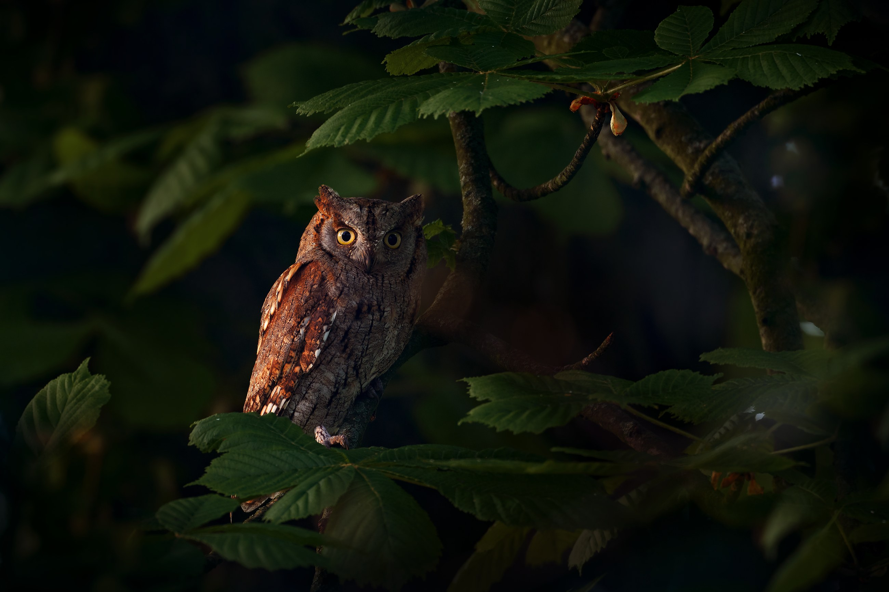

# ICT Webside

Jednoduchá webová stránka o fotografickém workshopu v Kostarice. Obsahuje informace o programu, termínu a registrační část.

## Web

  

## Náhled

### Fotografie z webu

## Soubory

- `index.html` – obsah stránky
- `styles.css` – vzhled a responzivní zobrazení
- `script.js` – interakce na stránce
- `Img/` – obrázky použité na webu

## Spuštění lokálně

Otevři soubor `index.html` v prohlížeči.
